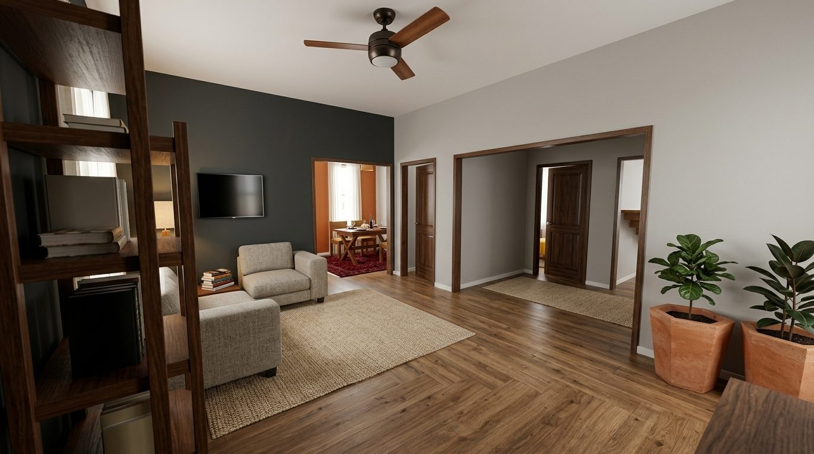
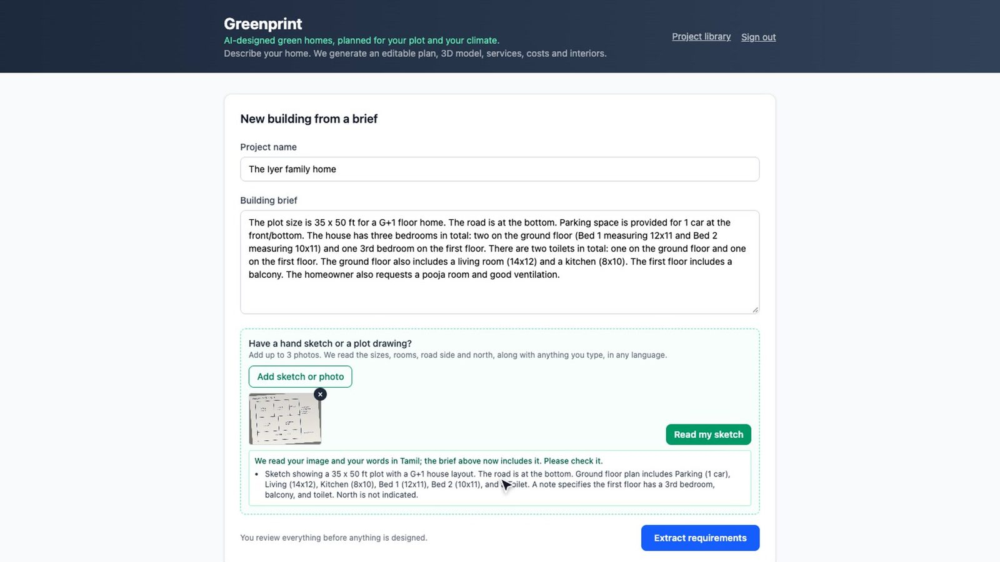
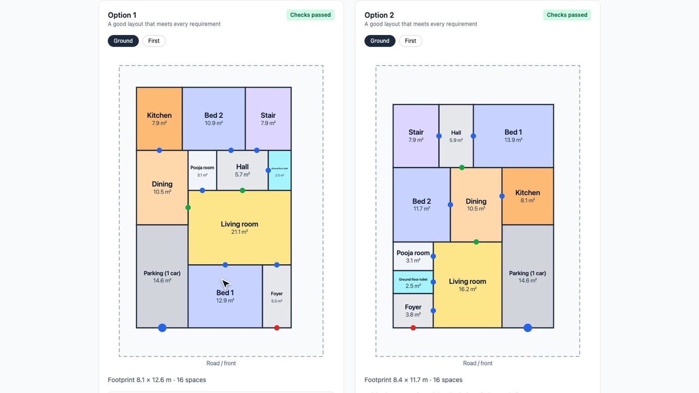
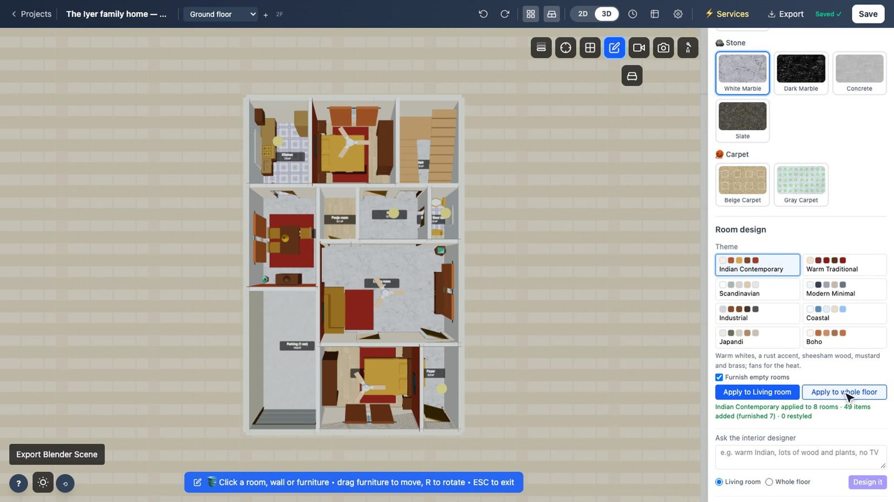
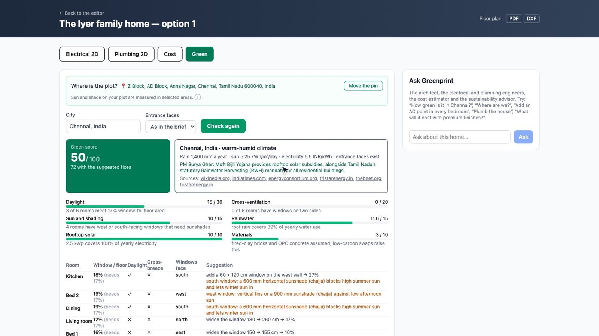
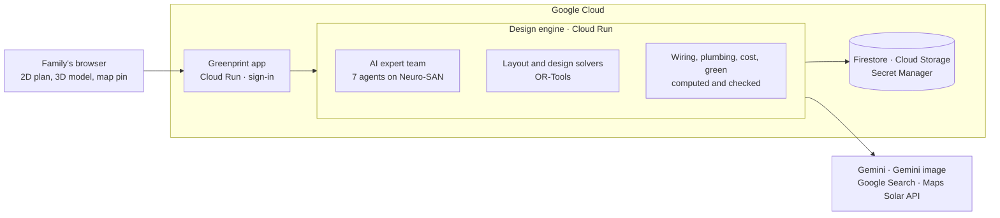
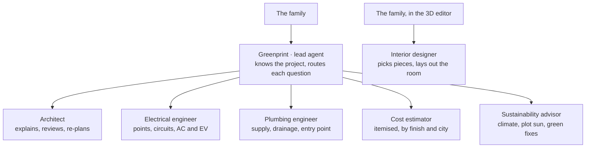

# Greenprint

**AI-designed green homes, planned for your plot and your climate.**

Most families build their home without an architect or an engineer. The home ends up dark, hot, costly to run and
over budget, and fixing that after construction is expensive. Greenprint gives every family a team of AI experts:
describe the home in a few lines, or photograph a hand sketch with notes in Hindi, Tamil, Japanese, Bahasa and more,
and Greenprint turns it into a home they can build, with every result checked before they see it.

**Live app:** https://constructos-app-863964949473.asia-south1.run.app (sign-in details are in the submission deck)

Built by team **ALIVE** (Cognizant AI Lab) for the AI Builder Cup 2026, theme *Sustainability & Social Impact*.



## What it does

| | |
|---|---|
| **Sketch to brief** | Reads a sketch photo and handwritten or typed notes, and writes the brief; the family checks every room and floor |
| **Complete layouts** | Designs whole homes from scratch in about 20 seconds, every room reachable, with an architect's review |
| **2D plan and 3D model** | Edit the plan, walk around the model, print it as scaled PDF or DXF drawings |
| **Lights and water** | Lights, switches, sockets and circuits; water supply and drainage, floor by floor |
| **Cost** | An itemised estimate, line by line, by finish and city |
| **Interiors** | Eight styles that paint, furnish and light every room; an interior designer that works from a description; photo-real renders |
| **Green check** | The plot's local climate and its own sun and shade: daylight, breeze, sun on walls, rainwater, rooftop solar and carbon, with fixes applied to the plan |
| **Ask Greenprint** | One chat with the whole expert team, at any step |

<table>
<tr>
<td></td>
<td></td>
</tr>
<tr>
<td></td>
<td></td>
</tr>
</table>

## How it works



### The agent network

Seven agents run on Gemini, built with [Neuro-SAN](https://github.com/cognizant-ai-lab/neuro-san). The family talks
to one lead agent, which brings in the right expert. The interior designer works directly from the 3D editor.



Every expert works on the real design through coded tools: it reads and changes the saved plan, wiring, pipes,
estimate and green report, so the numbers are computed and checked, never guessed. Plan geometry passes between
agents as private data and never goes to the model. The family approves each step and can keep or discard every
design.

## Built with

- **Gemini**: the agents, sketch reading, the architect's review, photo-real renders, local climate through Google Search
- **Neuro-SAN** (Cognizant AI Lab): the agent networks, in `engine/constructos_engine/agents/registries/`
- **Google Cloud**: Cloud Run, Firestore, Cloud Storage, Secret Manager, Cloud Build
- **Google Maps Platform**: Maps JavaScript and Geocoding for the plot pin, Solar API for the plot's sun and shade
- **Engine**: Python, FastAPI, OR-Tools, NetworkX, Shapely
- **Editor**: SvelteKit and Three.js, based on [openPlan3D](https://github.com/laanlabs/openPlan3D)

## Repository

| Path | What |
|---|---|
| `app/` | SvelteKit web app and the 2D/3D editor |
| `engine/` | Python engine: agents, layout solver, services routing, cost, green check, exports |
| `deploy/` | Google Cloud setup and Cloud Run deployment |

(Code identifiers use the working name `constructos`.)

## Run locally

Needs Node 22, Python 3.12 and [uv](https://docs.astral.sh/uv/).

```sh
cp .env.example .env          # add GEMINI_API_KEY (or Vertex AI settings); MAPS_SOLAR_KEY is optional
(cd engine && uv sync)
(cd app && npm ci)

(cd engine && uv run python -c "from constructos_engine.main import run; run()")   # http://127.0.0.1:8787
(cd app && npm run dev)                                                             # http://localhost:5173
```

The map pin needs a Maps JavaScript key: start the app with `MAPS_BROWSER_KEY=… npm run dev`. Without a Solar API
key, the green check uses the city's climate instead of the plot's own sun. Locally, everything is stored under
`engine/data/`; set `CONSTRUCTOS_STORE=gcp` to use Firestore and Cloud Storage.

## Deploy to Google Cloud

```sh
gcloud config set project <your-project>
deploy/setup.sh                  # once: APIs, Firestore, bucket, Artifact Registry, service accounts
deploy/maps-keys.sh              # Maps keys, stored in Secret Manager
deploy/set-login.sh --generate   # the shared sign-in; prints a generated password once
deploy/deploy.sh                 # builds both images and deploys to Cloud Run (ONLY=engine|app)
```

The engine is private and reachable only by the app's service identity. Keys and the sign-in live in Secret
Manager; nothing secret is stored in the repository.

## Tests

```sh
(cd engine && uv run pytest)
(cd app && npx vitest run tests/constructos-*.test.ts)
(cd app && NODE_ENV=production npm run build && npx playwright test -c playwright.constructos.config.ts)   # live journeys, needs a key
(cd engine && uv run python evals/agent_team_eval.py 3)                                                    # live agent evals
```

## Notes

Layouts, diagrams and estimates are planning outputs under stated assumptions, not certified engineering or
construction drawings. The plot's own sun and shade are available where Google's Solar API has imagery (most of
India and many cities worldwide); elsewhere the city's climate is used.

## Licence

Apache License 2.0, see [LICENSE](LICENSE). `app/` is derived from openPlan3D (MIT, see `app/LICENSE` and
`app/UPSTREAM.md`); 3D models are by Kenney (CC0, see `app/static/models/`) and texture credits are in
`app/static/textures/CREDITS.md`.
